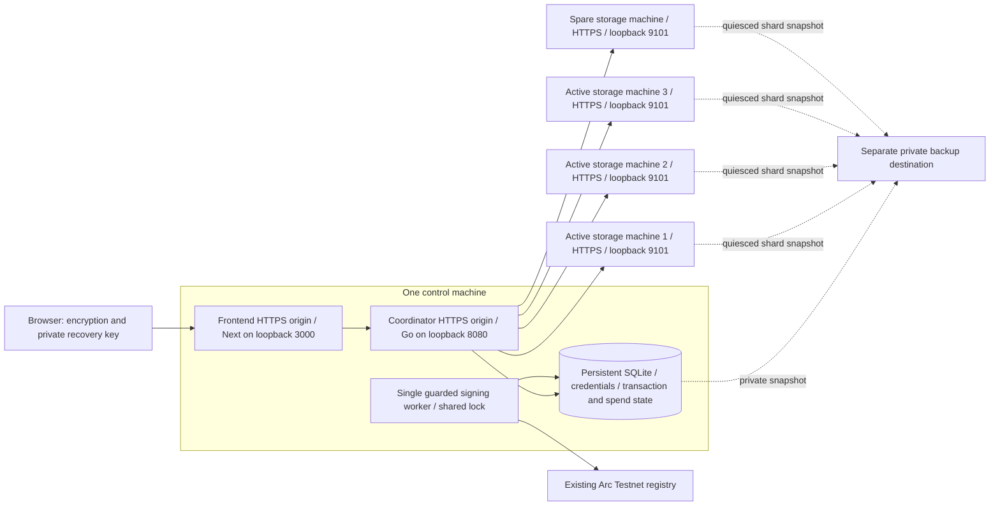

# Independent-host pilot handoff

Status: preparation only. Select the reviewed full release commit with passing
checks recorded in [development status](../DEVELOPMENT_STATUS.md); the older
`1157d38` tooling baseline predates the review fixes. No hosts are selected or
provisioned by this document. Commands below are operator instructions for selected, authorized
targets; none were executed as part of this handoff. Remote failure execution and
restore-candidate activation remain disabled.

Reuse Arc Testnet chain **5042002**, registry
`0xe1fC5025261af42dfe04788c7a09DAd3ea1EC435`, and dedicated signer
`0xFdE02e33287b161f797A3C2c63EE08c3673C591E`. Public transaction evidence is in
[Arc acceptance](arc-testnet-acceptance.md). Registry deployment is complete;
service deployment below does not create another registry/account/journal.

## Minimal topology

Five service machines, plus an operator/build environment and an already-owned
off-machine backup destination:



The frontend and coordinator need **distinct HTTPS origins**, even when they share
one IP/machine. Keep the worker on the coordinator machine: current tooling shares
its local SQLite database and filesystem signing lock. Moving signing to a second
host or mounting SQLite/locks over a network filesystem is outside this topology.
The current custody adapter is a local encrypted keystore, not a remote signer.

The four storage machines each need a persistent filesystem, their own HTTPS
origin, unique node token, stable URL and declared independent failure domain.
`TANK_NODES` is ordered **active 1, active 2, active 3, spare**. Initially each
segment has four data plus two parity shards, with two shards on each active
machine. Any four valid shards reconstruct it. One active-machine loss can be
repaired onto the spare. New uploads choose three eligible healthy configured
nodes, including the spare, with observed whole-file headroom and two shards per
declared failure domain. Existing manifests retain their recorded placements.
Supply `TANK_NODE_FAILURE_DOMAINS_FILE` using the
[mapping template](../deploy/pilot/node-failure-domains.json.example), and keep
`TANK_REQUIRE_NODE_FAILURE_DOMAINS=true` for the hosted pilot. Map endpoints on
the same machine/shared failure boundary to the same label. Labels and distinct
hostnames cannot prove infrastructure independence; operator inventory and actual
independent-host acceptance remain required. See [placement behavior](storage-placement.md).

The control machine is a metadata/frontend/signing single point of failure. The
registry alone cannot recover metadata, credentials, filenames or shards. Current
restore automation rejects stale state and needs the newest live comparison
baseline; loss of that baseline is a documented disaster-recovery gap, not an
automatic failover capability.

## Hardware, capacity and bandwidth

**All sizing below is an unmeasured planning assumption, not a tested minimum,
throughput guarantee or approved capacity increase.** Keep checked-in limits
unchanged initially and measure before admitting external users.

| Role | Starting CPU/RAM assumption | Persistent space assumption | Network assumption |
| --- | --- | --- | --- |
| Combined frontend/coordinator/worker | 4 vCPU, 4 GiB RAM | At least 20 GiB free after OS installation for metadata/WAL, runtime artifacts/cache and snapshot staging; size backup staging separately | Plan for 100 Mbit/s usable bidirectional connectivity; measure under concurrent upload, retrieval, audit and repair |
| Each of 3 active nodes | 2 vCPU, 2 GiB RAM | At least 20 GiB free after OS installation, with the template's 10 GiB retained-shard quota | Same 100 Mbit/s planning target; budget ingress and egress separately |
| Spare node | Same as an active node | Same capacity/headroom; remain running, monitored and initially without placements | Must be reachable and able to receive repair traffic |
| Separate build/acceptance environment | 4 vCPU, 8 GiB RAM as a starting build assumption | Space for clean worktree, npm dependencies, browser and release artifacts; measure actual usage | Release download/upload plus access to all selected HTTPS origins and SSH aliases |

The templates cap ciphertext uploads at 16 MiB, segments at 4 MiB, coordinator
concurrency at 4 (2/user), logical storage at 1 GiB/user and 10 GiB total, and
retained node bytes at 10 GiB/node. Frontend concurrency is 8; node concurrency
is 16. These are configuration limits, not proof that the assumed machines can
sustain them. Browser encryption adds envelope/name overhead to plaintext size.

For ciphertext volume **S**, coding adds approximately 50% before segment padding,
filesystem metadata, retained partial writes and snapshots. At the 10 GiB logical
cap, initial active-node data is approximately 5 GiB/node (15 GiB total). Retaining
the lost node's old data plus a repaired spare copy can bring that set to roughly
20 GiB across four nodes. These calculations assume the current two-shards/node
placement; measure actual disk bytes and inodes rather than treating them as quotas.

Per upload, frontend-to-coordinator payload is S and coordinator-to-node traffic
is about 1.5S. Healthy retrieval currently fetches the six recorded shards (about
1.5S) before returning S through the frontend. Retries, repair, audits, TLS and
backups add traffic. Supply a monthly egress allowance and recovery window based
on expected file sizes, upload/retrieval counts and repair volume; none is assumed
unlimited. Node requests have a 10-second client timeout, so measure slow-path
behavior as well as averages. Existing loopback measurements in
[pilot operations](pilot-operations.md) are not independent-host benchmarks.

## OS, ports, TLS and access

Use supported Linux with systemd, stable machine identity, time synchronization,
persistent local disk, and a service account named `tank`. Build Go from the
repository's `go.mod` version declaration (currently Go 1.26.0); use Node 24 or
later as required by the SDK, lockfile installs and the same architecture/Node
major at build and runtime. Python 3.11+ and OpenSSH are required on the operator
environment; the five SSH targets need Python 3, systemctl and `/etc/machine-id`.
Local restore fixtures additionally require Linux PID descriptors; they are not
a remote activation mechanism.

| Traffic | Port / binding | Allowlist |
| --- | --- | --- |
| Browser to frontend | TCP 443 through selected TLS proxy | Intended pilot clients; authentication still applies |
| Frontend/operator to coordinator | TCP 443 through TLS proxy | Control host frontend, approved acceptance/monitoring/operator sources |
| Coordinator/operator to each node | TCP 443 through TLS proxy | Control host plus approved acceptance/monitoring/operator sources |
| Backends | Frontend 127.0.0.1:3000, coordinator 127.0.0.1:8080, each node 127.0.0.1:9101 | Loopback only; never publish these ports |
| Operator SSH | Chosen SSH port (22 if unchanged) | Named operator sources; key authentication and independently verified host keys |
| TLS issuance/renewal | TCP 80 if the selected certificate method needs it, otherwise its chosen DNS/HTTPS method | Operator must specify challenge/firewall/renewal design |
| Egress | DNS, time synchronization, HTTPS to nodes/RPC; release/backup destinations as selected | Required destinations only; no public wallet-unlock RPC |

Use [Caddy's example blocks](../deploy/pilot/Caddyfile.example), one role block
per node and frontend/coordinator blocks on the control host, or an equivalent
reviewed proxy. The template leaves certificate/DNS/renewal setup to the operator.
Certificates must validate through the application/operator OS trust stores;
hostname mismatches, invalid certificates and redirects are rejected. Make proxy
body limits and deadlines compatible with the 16 MiB encrypted-body cap and
120-second frontend/coordinator request budget. Keep exact origin/forwarded host
and protocol intact; do not strip the browser Origin header.

Current hosted preflight accepts **distinct lowercase HTTPS origins on port 443**,
no path/query/credentials, and requires DNS answers to be globally routable. A
firewall-restricted public origin fits this validator; private-only DNS/VPN origins
do not currently pass it. The operator runner needs allowed network access to all
six origins (frontend, coordinator, four nodes). It also requires five distinct
SSH aliases and machine IDs. Machine IDs and labels do not prove physical
independence: record provider, physical placement/availability zone, region,
power/network dependency and operator ownership for every storage host.

Provide noninteractive SSH read access to service state and machine ID for
preflight (`BatchMode=yes`, `StrictHostKeyChecking=yes`). Installation/maintenance
needs separately scoped administrative access to the named Tank units, private
files and backup tooling. Record exact service ownership and future failure
targets; no wildcard service-stop or arbitrary remote command authority is implied.

## Private inputs: exact template contract

Keep runtime files outside Git. Service environment files are root:tank mode0640;
state directories are tank:tank mode0700. Credential maps, encrypted keystore,
password, deployment journal and snapshots are tank-owned mode0600 (or0400 when
read-only) in private directories. Reuse existing account and newest journal state;
file paths must be absolute, stable and free of symlink aliases. Preserve DB/WAL
state through the existing snapshot procedure, not a raw live `.sqlite` copy.

| File / input owner | Exact fields to supply or retain |
| --- | --- |
| Build environment | `TANK_SITE_URL`: selected frontend root HTTPS URL; `TANK_ALLOW_INDEXING=false` for the pilot. Retain canonical/Open Graph/robots configuration. |
| `/etc/tank/frontend.conf` ([template](../deploy/pilot/frontend.conf.example)) | `TANK_FRONTEND_ORIGIN` equals the selected frontend origin; `TANK_API_URL` is coordinator HTTPS origin; stable private `TANK_SESSION_SECRET`; retain `TANK_MAX_FILE_BYTES=16777216`, `TANK_FRONTEND_MAX_CONCURRENT_REQUESTS=8`, `TANK_REQUEST_TIMEOUT_SECONDS=120`. No admin, node or signing credentials. |
| `/etc/tank/coordinator.conf` ([template](../deploy/pilot/coordinator.conf.example)) | `TANK_COORDINATOR_ADDR=127.0.0.1:8080`; `TANK_DATABASE_PATH` points to the authoritative existing coordinator/Arc journal; ordered `TANK_NODES`; `TANK_NODE_CREDENTIALS_FILE`; `TANK_NODE_FAILURE_DOMAINS_FILE`; `TANK_REQUIRE_NODE_FAILURE_DOMAINS=true`; existing private `TANK_API_TOKEN`; retain all template limits below and public registration identity. No signing/RPC credentials. |
| `/etc/tank/node-credentials.json` ([template](../deploy/pilot/node-credentials.json.example)) | Exact canonical node HTTPS URL → its unique private token, matching all four `TANK_NODES` URLs with no trailing slash. Only coordinator/operator custody has the complete map. |
| `/etc/tank/node-failure-domains.json` ([template](../deploy/pilot/node-failure-domains.json.example)) | Exact same node URL set → operator-declared domain labels, matching the accepted host inventory. Protect configuration from unauthorized writes. Multiple endpoints on one machine/shared failure boundary use one label. |
| Each `/etc/tank/node.conf` ([template](../deploy/pilot/node.conf.example)) | `TANK_NODE_ADDR=127.0.0.1:9101`; persistent `TANK_NODE_DATA_DIR`; that node's unique `TANK_NODE_TOKEN`; retain `TANK_NODE_STORAGE_BYTES=10737418240`, `TANK_NODE_MAX_FILES=100000`, `TANK_NODE_MAX_CONNECTIONS=64`, `TANK_NODE_MAX_CONCURRENT_REQUESTS=16`, `TANK_REQUEST_TIMEOUT_SECONDS=120`. Never copy another node's token here. |
| `/etc/tank/registration-worker.conf` ([reference](../deploy/arc-testnet/testnet.conf.example)) | Existing `TANK_ARC_TESTNET_RPC` supplied privately; published `TANK_ARC_TESTNET_SENDER`/`TANK_REGISTRY_ADDR`, `TANK_CHAIN_ID=5042002`; same `TANK_DATABASE_PATH` as coordinator; one stable `TANK_REGISTRATION_LOCK_PATH` (default DB path plus `.registration.lock`); existing `TANK_SIGNER_KEYSTORE_FILE`, `TANK_SIGNER_PASSWORD_FILE`, `TANK_ARC_DEPLOY_JOURNAL`; verified `TANK_ARC_DEPLOY_ARTIFACT`; unchanged gas/fee/total ceilings below. `TANK_ARC_TESTNET_ACCOUNT` is an operator label in the example, not the Go CLI's custody selector. |
| Proxy / host inventory | Actual DNS names, certificate method/custody/renewal, firewall sources, SSH aliases/ports/host keys, service owners and persistent mounts. Secret DNS/provider authentication stays in private local files. |
| Operator acceptance JSON ([schema/template](../deploy/pilot/hosted-acceptance.example.json)) | `version=1`; `frontend_url`; coordinator `url,failure_domain,ssh_alias,service,registration_service,registration_timer`; four ordered nodes each `url,failure_domain,ssh_alias,service`; `credentials.user_a,user_b` pointing to two distinct synthetic individual-user JSON files; recovery `snapshot_binary,live_database,snapshot_database,restored_database` as distinct canonical remote paths; Arc `rpc_url,chain_id,registry`. Config and both credentials: operator-owned mode0600, immediate parent mode0700, no symlinks. |

Retain coordinator defaults: `TANK_MAX_SEGMENT_BYTES=4194304`,
`TANK_MAX_FILE_BYTES=16777216`, `TANK_MAX_CONCURRENT_REQUESTS=4`,
`TANK_MAX_CONCURRENT_PER_USER=2`, `TANK_MAX_CONNECTIONS=64`,
`TANK_REQUESTS_PER_MINUTE=300`, `TANK_REQUEST_BURST=60`,
`TANK_USER_STORAGE_BYTES=1073741824`, `TANK_TOTAL_STORAGE_BYTES=10737418240`,
`TANK_REQUEST_TIMEOUT_SECONDS=120`, `TANK_REGISTRATION_MODE=arc-testnet-external`,
and the public chain/registry/sender above.

Worker ceilings in native **18-decimal** gas units: registration max gas1000000,
max fee65000000000, max tip1000000000, per-file cost8000000000000000,
aggregate100000000000000000, confirmations1. Deployment values remain gas1000000,
fee65000000000, tip1000000000, cost40000000000000000. These correspond to
65 Gwei / 0.008 registration / 0.10 cumulative / 0.04 deployment testnet USDC.
Retain an existing stricter gas limit if configured; never reset the spend counter
or increase any cap to enable hosting. The timer is a five-minute bounded oneshot
with jitter; only one signing host/account lane is permitted.

Use the exact worker variable names from the reference: `TANK_ARC_TESTNET_MAX_GAS`,
`TANK_ARC_TESTNET_MAX_FEE`, `TANK_ARC_TESTNET_MAX_TIP`,
`TANK_ARC_TESTNET_MAX_COST`, `TANK_ARC_TESTNET_TOTAL_BUDGET`,
`TANK_ARC_TESTNET_CONFIRMATIONS`; deployment uses `TANK_ARC_DEPLOY_MAX_GAS`,
`TANK_ARC_DEPLOY_MAX_FEE`, `TANK_ARC_DEPLOY_MAX_TIP`, `TANK_ARC_DEPLOY_MAX_COST`.

The hosted JSON's RPC is currently a public root HTTPS origin without a provider
credential path/query. Reuse a suitable selected public endpoint there. The worker
can use its separately selected secret HTTPS provider URL privately; do not put
such credentials into a handoff response, CLI argument or public inventory.
Systemd environment files contain `NAME=value`, not shell `export` statements;
do not source them as shell scripts. Use the existing shell-format `worker.env`
only as documented in [Arc setup](arc-testnet-deployment.md), or load the systemd
file via systemd as below. Never regenerate the existing keystore or journal.

## Release and service-deployment commands

These commands are for later operator execution. Supply actual local paths and
public origins privately; placeholders are not deployable targets. Installation
on a control host requires an agreed authoritative-state/custody handover: stop
the old timer, wait for its worker to finish, preserve the newest DB/deployment
journal/lock/gates and credentials, and keep the old lane inactive. No automatic
state transfer or remote cutover is implemented. Do not start a fresh journal or
second worker as a shortcut.

From the repository root on an existing build environment, choose a new clean
worktree and the public frontend origin (no credentials in these inputs):

```bash
set -euo pipefail
set +x
umask 077
read -r -p 'Verified full release commit (40 lowercase hex characters): ' TANK_RELEASE_COMMIT
[[ "$TANK_RELEASE_COMMIT" =~ ^[0-9a-f]{40}$ ]]
read -r -p 'New absolute release worktree path: ' TANK_RELEASE_TREE
read -r -p 'Selected public frontend HTTPS origin: ' TANK_PILOT_ORIGIN
git worktree add --detach "$TANK_RELEASE_TREE" "$TANK_RELEASE_COMMIT"
cd "$TANK_RELEASE_TREE/tank"
go mod verify
go build -trimpath -o bin/ ./cmd/...
cd sdk-ts
npm ci
npm run build
cd ../frontend
npm ci
TANK_SITE_URL="$TANK_PILOT_ORIGIN" TANK_ALLOW_INDEXING=false npm run build
```

Record full commit, OS/architecture, Go/Node/npm versions and artifact checksums.
These are future release builds, not a request to rerun already-passing test suites.
Supply the already-verified compiled TankRegistry artifact to the worker; if an
artifact must be reproduced, use the checksum-pinned Arc tools and
`TANK_ARC_FORGE_BIN=/PATH/TO/PINNED/arc-forge` with
`"$TANK_ARC_FORGE_BIN" build --root contracts` from `tank/`. Verify runtime identity
through the read-only checker; never use a deploy/broadcast flag to build artifacts.

Stage public release files under `/opt/tank` on the selected machines. Control:
`bin/coordinator`, `bin/tank-access`, `bin/tank-backup`,
`bin/tank-prepare-registration`, `bin/tank-restore-check`, compiled artifact;
frontend `.next`, `public`, `node_modules`, package/config/source files and the
linked `sdk-ts` tree with the same relative paths. Node hosts: `bin/tank-node`.
Keep release artifacts root-owned/read-only to `tank`; make
`/opt/tank/frontend/.next/cache` tank-writable as required by its unit. Exclude
`.env*`, credentials, custody, databases, logs and recovery keys from release copies.
Select a reviewed upload/copy mechanism and create the service account first.

Install only the units for each selected role, from the staged clean release;
leave the registration timer **installed but disabled** until the authoritative
state, custody and signing-lane cutover is reviewed. Example control-host commands:

```bash
set -euo pipefail
set +x
umask 077
cd /opt/tank
sudo install -d -o root -g tank -m 0750 /etc/tank
sudo install -d -o tank -g tank -m 0700 /var/lib/tank-coordinator
sudo install -d -o tank -g tank -m 0700 /var/lib/tank-frontend
sudo install -d -o tank -g tank -m 0700 /opt/tank/frontend/.next/cache
sudo install -o root -g root -m 0644 deploy/pilot/systemd/tank-coordinator.service /etc/systemd/system/
sudo install -o root -g root -m 0644 deploy/pilot/systemd/tank-frontend.service /etc/systemd/system/
sudo install -o root -g root -m 0644 deploy/pilot/systemd/tank-registration-worker.service /etc/systemd/system/
sudo install -o root -g root -m 0644 deploy/pilot/systemd/tank-registration-worker.timer /etc/systemd/system/
# Install completed PRIVATE configs separately; refuse replacement of existing files.
for TANK_CONFIG_FILE in frontend.conf coordinator.conf registration-worker.conf node-credentials.json node-failure-domains.json; do
  sudo test ! -e "/etc/tank/$TANK_CONFIG_FILE"
  sudo test ! -L "/etc/tank/$TANK_CONFIG_FILE"
done
read -r -p 'Private config staging directory: ' TANK_PRIVATE_CONFIG_DIR
sudo install -o root -g tank -m 0640 "$TANK_PRIVATE_CONFIG_DIR/frontend.conf" /etc/tank/frontend.conf
sudo install -o root -g tank -m 0640 "$TANK_PRIVATE_CONFIG_DIR/coordinator.conf" /etc/tank/coordinator.conf
sudo install -o root -g tank -m 0640 "$TANK_PRIVATE_CONFIG_DIR/registration-worker.conf" /etc/tank/registration-worker.conf
sudo install -o tank -g tank -m 0600 "$TANK_PRIVATE_CONFIG_DIR/node-credentials.json" /etc/tank/node-credentials.json
sudo install -o root -g tank -m 0640 "$TANK_PRIVATE_CONFIG_DIR/node-failure-domains.json" /etc/tank/node-failure-domains.json
# Retain authoritative state and encrypted custody separately using the reviewed
# private handover procedure; never initialize replacement journals here.
sudo systemd-analyze verify /etc/systemd/system/tank-coordinator.service /etc/systemd/system/tank-frontend.service /etc/systemd/system/tank-registration-worker.service /etc/systemd/system/tank-registration-worker.timer
sudo systemctl daemon-reload
```

Staging must also include `deploy/pilot/systemd/` for these exact paths. Apply
`set -euo pipefail; set +x; umask 077` in each operator shell. The existence/symlink
guards are intended for first installation; existing installations need a reviewed
config/release update, not an overwrite of custody or live data.

On **each** selected node, with its own completed private node config:

```bash
set -euo pipefail
set +x
umask 077
cd /opt/tank
sudo install -d -o root -g tank -m 0750 /etc/tank
sudo install -d -o tank -g tank -m 0700 /var/lib/tank-node
sudo test ! -e /etc/tank/node.conf
sudo test ! -L /etc/tank/node.conf
read -r -p 'This node private config file: ' TANK_PRIVATE_NODE_CONFIG
sudo install -o root -g tank -m 0640 "$TANK_PRIVATE_NODE_CONFIG" /etc/tank/node.conf
sudo install -o root -g root -m 0644 deploy/pilot/systemd/tank-node.service /etc/systemd/system/
sudo systemd-analyze verify /etc/systemd/system/tank-node.service
sudo systemctl daemon-reload
```

After persistent data paths, DNS/TLS/firewalls, configs and owner-supplied targets
are verified, start storage first (including the spare), then control services:

```bash
# Each node host:
sudo systemctl enable --now tank-node.service
# Control host, after all four node HTTPS health checks succeed:
sudo systemctl enable --now tank-coordinator.service tank-frontend.service
sudo systemctl is-enabled tank-registration-worker.timer
```

The last command reports timer enablement and can return nonzero for an intentionally
disabled timer. It does not start it. This handoff includes no worker/timer enable,
registry deployment, remote failure or restore activation command.

## Acceptance commands and evidence boundaries

Create two synthetic individual-user credentials **only after the authoritative
DB is installed**, from the control host. Choose new destinations; preserve all
existing users/keys. Keep the credential JSONs on the private operator environment
using an approved confidential transfer, not chat or Git:

```bash
sudo -u tank /opt/tank/bin/tank-access create --db /var/lib/tank-coordinator/tank.sqlite --label 'Pilot acceptance A' --out /var/lib/tank-coordinator/acceptance/user-a.json
sudo -u tank /opt/tank/bin/tank-access create --db /var/lib/tank-coordinator/tank.sqlite --label 'Pilot acceptance B' --out /var/lib/tank-coordinator/acceptance/user-b.json
```

Each credential expires (current tool defaults are not a permanent entitlement).
Record IDs privately for renewal/revocation; do not recreate a principal to renew
access. Use `tank-access issue --db ... --user-id ... --out NEW_FILE` for continuity.

On the operator environment from the selected release's `tank/`, set the private
config path, then use the existing hosted runner:

```bash
set +x
umask 077
read -r -p 'Absolute private hosted acceptance JSON: ' TANK_PILOT_CONFIG
python3 scripts/test-pilot-hosted.py --config "$TANK_PILOT_CONFIG" --validate-config-only
python3 scripts/test-pilot-hosted.py --config "$TANK_PILOT_CONFIG" --dry-run
# Later, once the named hosts are installed/approved and reachable:
python3 scripts/test-pilot-hosted.py --config "$TANK_PILOT_CONFIG"
```

Schema validation/dry run checks private-file metadata without contacting hosts.
The final command performs **read-only** HTTPS/TLS, public DNS, Arc chain/runtime
and SSH/service identity checks. Currently it expects coordinator/node services
active, registration oneshot inactive and its timer active. Until the reviewed
signing-host cutover enables that timer, full preflight will refuse this state;
record that gate instead of enabling broadcasting to make a test pass. An active
oneshot during a scheduled pass also fails its quiet-state expectation; wait for
that bounded pass to finish rather than interrupting a signer. Preflight is not
encrypted-file or independent-machine failure acceptance.

For an operator-approved **single** direct HTTPS browser smoke, from the built
release's `tank/frontend/`, choose public origin and private credential paths:

```bash
read -r -p 'Selected public frontend HTTPS origin: ' TANK_PILOT_ORIGIN
read -r -p 'Private user A credential file: ' TANK_PILOT_USER_A_FILE
read -r -p 'Private user B credential file: ' TANK_PILOT_USER_B_FILE
env -u TANK_E2E_UPSTREAM_URL -u TANK_E2E_CODESPACES_AUTH -u TANK_E2E_PILOT -u TANK_E2E_ACCESS_TOOL -u TANK_E2E_REPLACEMENT_FILE -u TANK_E2E_PAGINATION -u TANK_E2E_MAX_FILE_BYTES -u TANK_E2E_EXPECT_REGISTRATION_STATUS -u TANK_E2E_MEASURE \
  TANK_FRONTEND_ORIGIN="$TANK_PILOT_ORIGIN" \
  TANK_E2E_CREDENTIAL_FILE="$TANK_PILOT_USER_A_FILE" \
  TANK_E2E_OTHER_CREDENTIAL_FILE="$TANK_PILOT_USER_B_FILE" npm run test:browser
```

Install the checked-in Playwright Chromium with `npx playwright install chromium`
on that acceptance environment if it is not present. This smoke creates one
synthetic encrypted file and checks exact original bytes/Unicode filename, recovery
import and cross-user file/registration denial. It does not stop hosts, prove repair
or canonical chain confirmation, or retain a user recovery key for later use.
An already-active worker may register that file within the unchanged cumulative
budget; account for its permanent reservation and avoid repeated uploads. Retained
synthetic data is not permission to delete existing data.

For canonical read-only reconciliation on the control host, use the same private
systemd worker configuration, without exposing provider/custody values as arguments:

```bash
sudo systemd-run --unit=tank-pilot-readback --wait --collect --quiet --service-type=oneshot \
  --uid=tank --gid=tank --property=UMask=0077 --property=TimeoutStartSec=100 \
  --property=WorkingDirectory=/opt/tank \
  --property=EnvironmentFile=/etc/tank/registration-worker.conf \
  /opt/tank/bin/tank-restore-check --db /var/lib/tank-coordinator/tank.sqlite
```

This checker loads no signer and never broadcasts. It requires the existing
supported chain/account history and exact budgets; pending/ambiguous transactions,
unsupported mixed history or nonce conflicts block verification. Do not delete
jobs or reset reservations to get a passing result. For a reviewed inactive restore
candidate, substitute its **new private path** only; the checker cannot activate it
or remove maintenance gates.

There is **no enabled automated remote failure/restore command**. The reserved
`--execute-hosted-drill` flag fails closed. `npm run test:pilot` and
`scripts/pilot-restore.py --execute-local-fixture` are local simulations, not remote
adapters. Once inventory and activation ownership are supplied, finish and review
the adapter before selecting an owned active-node failure, spare repair, restart,
interrupted restore and recovery test. Preserve all journals/gates and credential
revocations under [restore safety](hosted-restore-safety.md).

## Monitoring and backup handoff

Assign a monitoring owner, alert destination, response contact and maintenance
window. Poll aggregate coordinator `/ops/status` about every 30 seconds with its
protected admin credential, and each node `/ops/status` with only its own token.
`/health` proves liveness only. Monitor upload readiness, degraded state, repair
backlog, audit age/failures, registration state, disk/inodes, CPU/RSS, restarts,
latency/timeouts, TLS expiry/renewal and backup age/restore outcome. Thresholds and
retention are owner decisions to calibrate from measured load, not invented SLOs.
Keep tokens/cookies/provider URLs out of URLs, arguments, metric labels and logs.
Use [monitoring](monitoring.md) and [troubleshooting](pilot-troubleshooting.md).

Select an off-machine destination outside the control/storage failure domains,
with encryption, private access and a separate custody/recovery owner. Include:
consistent full SQLite snapshots (jobs, credentials/revocations, signed bytes,
nonces and permanent spend state); immutable deployment journal and signing-lane
controller/gates; private config/token map/session secret; encrypted keystore and
password in separately controlled recovery custody; and quiesced or atomic-volume
snapshots of every node's entire persistent shard root. Browser recovery keys stay
with users; operators must never collect them. Record snapshot age, checksums,
retention, off-machine copy completion, measured RPO/RTO and actual restore results.

Exact existing metadata snapshot command on the control host (choose an operator-
created private directory and a **new** path):

```bash
read -r -p 'New absolute private snapshot destination: ' TANK_PILOT_SNAPSHOT
sudo -u tank /opt/tank/bin/tank-backup --db /var/lib/tank-coordinator/tank.sqlite --out "$TANK_PILOT_SNAPSHOT" --timeout 2m
```

It refuses replacement and includes committed WAL state. This online snapshot is
not a signing quiescence/restore permit. Off-machine transfer, node snapshotting,
certificate renewal and monitoring agents depend on selected infrastructure and
are not automated/provisioned here. Stale snapshots cannot reactivate old credentials
or become signing sources; if the newest live baseline is lost, keep broadcasting
blocked and record the recovery gap.

## Decisions the owner must supply

- [ ] Five existing/authorized service machines: control and four storage roles;
  provider/region/physical failure-domain evidence, disk/mount ownership and operator.
  If new paid resources are needed, that authorization remains a separate decision.
- [ ] Six distinct public HTTPS origins, DNS/certificate ownership and renewal
  method, allowed ingress/egress sources and operator network access. Decide whether
  the current public-DNS/443 preflight model fits the intended network.
- [ ] Five private SSH aliases, ports, verified host keys, named operators and
  scoped administrative rights; exact owned services and candidate failure targets.
- [ ] Use the existing signing machine as control, or specify a reviewed single-
  lane custody/authoritative-state handover with the original lane stopped. Identify
  the existing DB/journal/keystore/password/artifact/lock paths privately; never
  send their contents, keys, passwords or secret provider URLs in chat.
- [ ] Workload envelope: users, file-size distribution, concurrency, upload/retrieve
  frequency, monthly bandwidth allowance and measurements that will validate the
  stated CPU/RAM/disk assumptions without silently raising limits.
- [ ] Monitoring owner/destination/contact, alert thresholds, log privacy/rotation,
  uptime observation period, patch window and incident/repair responsibilities.
- [ ] Backup destination/failure domain, encryption/access owners, snapshot schedule,
  retention, off-machine copy method and desired RPO/RTO to measure; decide how to
  address the lost-newest-journal recovery gap before relying on hosted retention.
- [ ] Two synthetic acceptance users and private credential-file custody; one
  approved smoke slot and remaining testnet funding within the existing budgets.
- [ ] Remote adapter/activation ownership and a failure/restore window. Require
  canonical file registration, exact recovery, cross-user denial, real active-host
  loss/spare repair, restart and safe interrupted recovery evidence before pilot
  acceptance. A preflight pass or local process drill cannot approve this gate.
- [ ] Pilot start/end/export dates, invite/data policy, support contacts, funding
  responsibility and operator-exit/handover choices from the unapproved
  [owner-decision draft](pilot-owner-decisions.md). No permanent retention or
  production-readiness promise is supplied by this handoff.

Public role/origin decisions can be shared for coordination. Put SSH/provider
authentication, node/user/admin credentials, custody and backup access into local
private files. No infrastructure, service, timer, transaction or remote failure is
activated by completing this checklist.
